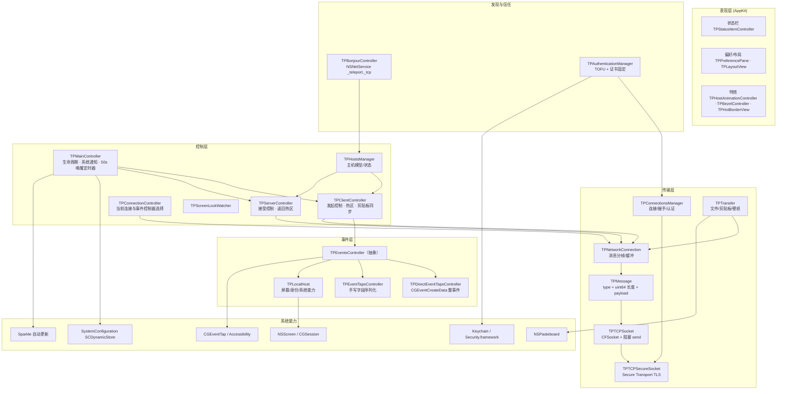
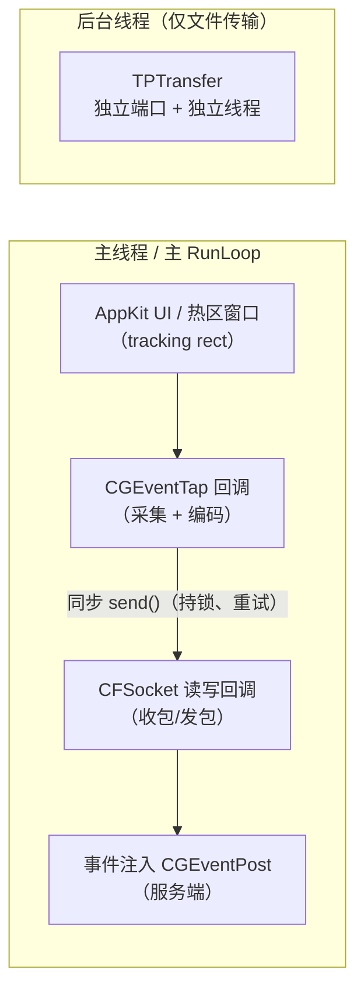
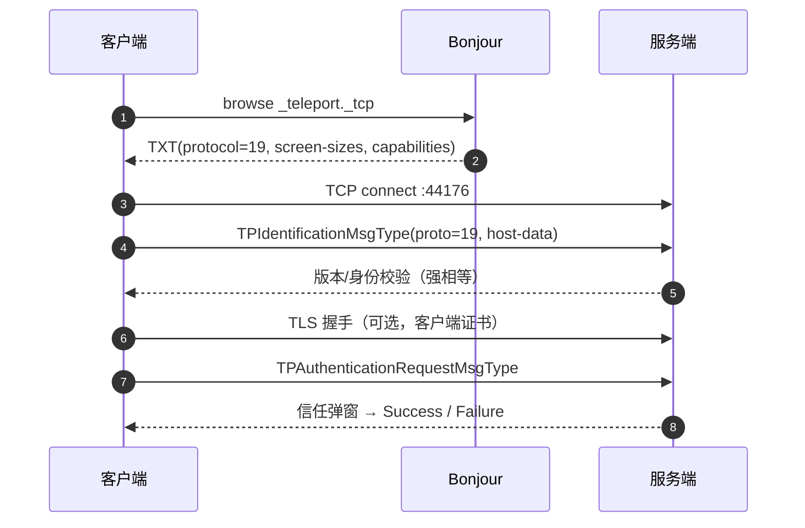
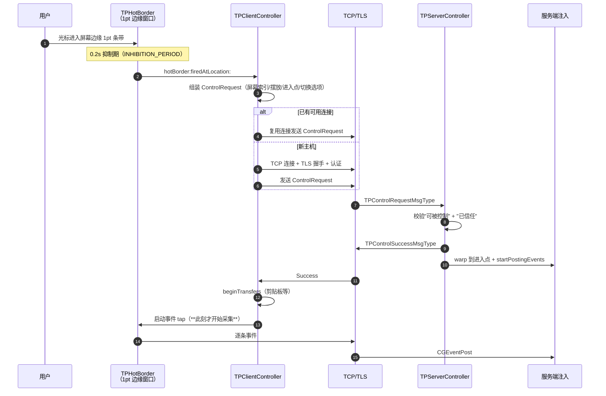
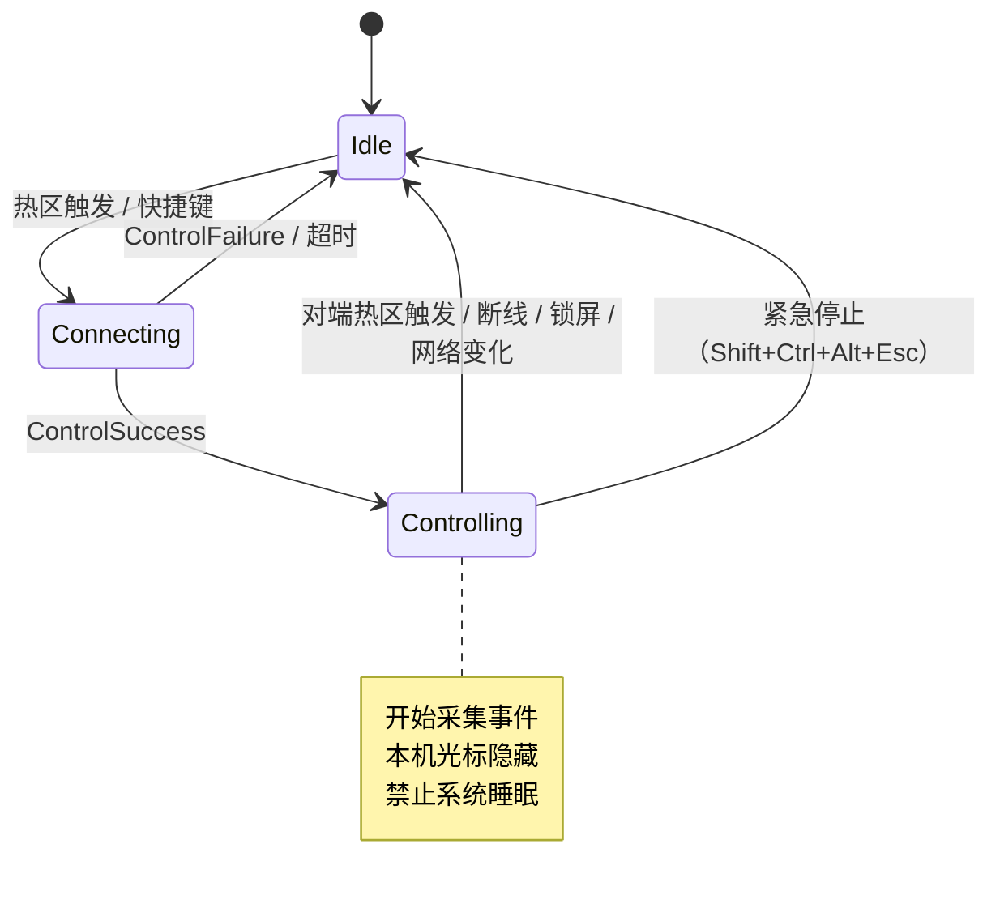

# Teleport 技术架构与「切换顺滑度」优化研究报告

| 项 | 内容 |
|---|---|
| 研究对象 | Teleport（macOS 虚拟 KVM），源码来自 `https://github.com/bennyhuo/teleport.git` |
| 代码版本 | `CURRENT_PROJECT_VERSION = 1.3.5`，`PROTOCOL_VERSION = 19` |
| 代码规模 | 65 个 `.m`（17,190 行）+ 头文件 2,662 行；Xcode 工程实际参与编译 62 个源文件 |
| 技术栈 | Objective-C + AppKit/Cocoa，CFSocket + Secure Transport，NSNetService，Sparkle 1.24 |
| 构建验证 | 已用 Xcode 27.1 构建出 `arm64 + x86_64` 通用 `teleport.app`（ad-hoc 签名），实机启动通过 |
| 研究方法 | 源码静态分析（关键路径逐行核对）+ 本机构建/运行验证 + 调用链追踪 |
| 说明 | 文中所有延迟数值均为**按代码路径推断的量级估算**，非实测；实测方案见第 10 节 |

---

## 1. 执行摘要

1. **Teleport 的核心机制很简单**：客户端用 `CGEventTap` 吞掉本机键鼠事件 → 自定义二进制协议经 TCP 发到对端 → 对端用 `CGEventPost` 回放。它不是屏幕共享，不传视频，只传事件与一小张壁纸缩略图（`MAX_BACKGROUND_IMAGE_WIDTH 240`）。

2. **整体架构是 2003–2005 年的单线程设计**，后续只做了最小修补：事件采集、事件编码、socket 阻塞写、事件注入**全部发生在主线程**（事件 tap 的 RunLoop source、CFSocket 都挂在主 RunLoop）。

3. **"不丝滑"的主因不是协议算法，而是四个工程性问题**：
   - 主线程同步 `send()`（失败还会重试 10 次、持锁），一旦网络抖动就卡住事件采集；
   - 事件 tap 只注册在 `kCFRunLoopDefaultMode`，打开菜单/拖窗口/模态面板时**完全收不到事件**；
   - 每个鼠标事件单独建 1 个消息、多次内存拷贝、逐次 `write()`，没有任何合并/节流；
   - 屏幕边缘用 **1pt 热区窗口 + 0.2s 抑制期**，切换时还要等一次 RTT 才启动采集，期间事件直接丢弃。

4. **切换耗时中占比最大的一项其实是一个常量**：`INHIBITION_PERIOD = 0.2s`（[TPPreferencesManager.m:141](../TPPreferencesManager.m#L141)）。也就是说，即使局域网 RTT 只有 1ms，用户也要在边缘停 200ms 才能切过去；切换到新主机还要额外付出 TCP+TLS 握手。

5. **安全与维护性存在硬伤**：TLS 证书链校验被关闭（[TPTCPSecureSocket.m:120](../TPTCPSecureSocket.m#L120)），加密默认取决于本机是否有身份证书；`NSArchiver` 等已废弃 API 仍在消息层使用；`PROTOCOL_VERSION` 强相等校验，任何协议优化都必须做能力协商与兼容回退。

6. **最高性价比的 5 项改造**（详见第 9 节）：
   1. 事件采集/发送移出主线程（专用线程 + 无锁队列）；
   2. `kCFRunLoopDefaultMode` → `kCFRunLoopCommonModes`（一行改动）；
   3. 鼠标增量合并 + 批量编码 + 预分配缓冲；
   4. 纯增量维护虚拟光标位置，去掉每事件 `[NSEvent mouseLocation]` / `[NSScreen screens]`；
   5. 边缘预触发 + 连接预热 + 切换窗口期事件缓冲，实现"零等待"切换。

---

## 2. 研究对象与方法

### 2.1 结论所依赖的证据形态

- 关键路径均给到 `文件:行号`，可直接跳转核对；
- 所有"架构"描述以实际调用链为准，而非头文件命名；
- 工程中未被编译的历史文件（`TPEventsReceiver.m`、`TPEventsTransmitter.m`、`TPUDPSocket.m`）不计入运行架构，但在第 12 节作为技术债说明。

### 2.2 研究边界

- 本报告聚焦**输入转发链路与切屏手感**，不涉及文件传输协议细节的逐字节分析；
- 不包含竞品源码对比（Synergy/Deskflow 等仅作设计思路参考）；
- 未做端到端延迟实测，第 8 节的数字是**可解释的估算区间**，用于确定优化优先级，不作为验收基线。

---

## 3. 产品形态与运行模型

- 单进程、双角色：同一份 `teleport.app` 既是客户端（控制别人）也是服务端（被别人控制），由 `TPClientController` / `TPServerController` 分别承担。
- 菜单栏常驻：`LSUIElement = 1`（[Info.plist:32-33](../Info.plist#L32-L33)），无 Dock 图标，状态入口是 `TPStatusItemController`。
- 启动链：`main.m` → `NSApplicationMain` → `TPMainController applicationDidFinishLaunching`：
  初始化偏好 → 创建 Client/Server/Status 控制器 → 启动网络配置监听 → 载入主机与信任库 → `TPBonjourController browse` → 安装热区（[TPMainController.m:100-144](../TPMainController.m#L100-L144)）。
- 权限前提：**辅助功能（Accessibility）**。启动时 `AXIsProcessTrustedWithOptions` 检测，未授权则弹窗并退出（[TPMainController.m:328-338](../TPMainController.m#L328-L338)、[TPLocalHost.m:336-339](../TPLocalHost.m#L336-L339)）。

---

## 4. 架构总览

### 4.1 分层组件图



### 4.2 模块职责

| 模块 | 职责 | 关键文件 |
|---|---|---|
| `TPMainController` | App 生命周期、系统通知（睡眠/锁屏/显示器变化/网络变化）、50s 唤醒定时器、权限检查 | [TPMainController.m](../TPMainController.m) |
| `TPClientController` | 发起控制、屏幕边缘热区、切换选项下发、剪贴板同步、防睡眠 | [TPClientController.m](../TPClientController.m) |
| `TPServerController` | 接受/拒绝控制、返回用热区、注入准备、唤醒显示器 | [TPServerController.m](../TPServerController.m) |
| `TPConnectionController` | 当前连接持有、事件控制器选择、热区绑定 | [TPConnectionController.m](../TPConnectionController.m) |
| `TPEventsController` | 事件采集/注入抽象；按能力与 OS 版本选择实现 | [TPEventsController.m](../TPEventsController.m) |
| `TPDirectEventTapsController` | 利用 `CGEventCreateData/FromData` 整事件序列化（仅同大版本 OS） | [TPDirectEventTapsController.m](../TPDirectEventTapsController.m) |
| `TPEventTapsController` | 手写字段序列化/反序列化，跨 OS 版本兼容路径 | [TPEventTapsController.m](../TPEventTapsController.m) |
| `TPNetworkConnection` | 长度前缀分帧、连接态消息暂存、收包缓冲 | [TPNetworkConnection.m](../TPNetworkConnection.m) |
| `TPTCPSocket` | CFSocket 封装、同步 `send()`、TCP_NODELAY/IPTOS | [TPTCPSocket.m](../TPTCPSocket.m) |
| `TPTCPSecureSocket` | TLS（客户端证书、**关闭证书链校验**） | [TPTCPSecureSocket.m](../TPTCPSecureSocket.m) |
| `TPBonjourController` | 服务发布/发现、TXT 记录（屏幕尺寸、能力、OS 版本） | [TPBonjourController.m](../TPBonjourController.m) |
| `TPAuthenticationManager` | 首次信任弹窗、证书固定、信任库持久化 | [TPAuthenticationManager.m](../TPAuthenticationManager.m) |
| `TPHostSnapping` | 主机矩形贴边吸附（四方向最近距离） | [TPHostSnapping.m](../TPHostSnapping.m) |

### 4.3 线程模型（关键结论）



- 事件 tap 的 source 挂在 `CFRunLoopGetCurrent()`（主线程）的 `kCFRunLoopDefaultMode`（[TPEventTapsController.m:165-171](../TPEventTapsController.m#L165-L171)）；
- CFSocket 的 RunLoop 同样是 `CFRunLoopGetCurrent()`（[TPTCPSocket.m:175](../TPTCPSocket.m#L175)）；
- 只有文件/剪贴板传输走独立线程与独立端口（`COMMAND_PORT + 1`）。

> **这意味着：网络慢 → 主线程卡 → tap 回调延迟 → 系统判定 tap 超时禁用 → 鼠标"跳帧/卡死"。**

---

## 5. 核心流程

### 5.1 发现与配对

1. 服务发布：`_teleport._tcp`，端口 `44176`（Debug/预发布为 `44276`），传输端口 `+1`。
2. TXT 记录：`txtvers / id / name / protocol / screen-sizes / capabilities / os-vers / hide`。
3. 发现过滤：`txtvers == 1` 且 `protocol == PROTOCOL_VERSION(19)`，否则标记不兼容。
4. 首次控制：服务端弹窗询问，接受后写入信任库；后续以证书 DER 字节比对做固定（TOFU）。



### 5.2 建立控制与切换（重点）



**三个关键时间窗（体感来源）**：

| 时间窗 | 代码位置 | 影响 |
|---|---|---|
| 0.2s 抑制期 | [TPPreferencesManager.m:141](../TPPreferencesManager.m#L141) / [TPHotBorder.m:217-227](../TPHotBorder.m#L217-L227) | 每次到边缘都要"停一下"，是切屏延迟的最大固定项 |
| 连接 RTT（新主机还要 TCP+TLS） | [TPClientController.m:298-337](../TPClientController.m#L298-L337)、[TPConnectionController.m:63-72](../TPConnectionController.m#L63-L72) | 切换新主机时连接建立耗时；且旧连接被立即断开 |
| 等待 Success 后才启动 tap | [TPClientController.m:407-408](../TPClientController.m#L407-L408) | 这段窗口内的鼠标移动**不缓存、直接丢失** |

### 5.3 控制状态机



---

## 6. 关键实现细节

### 6.1 事件捕获

| 项 | 取值 | 位置 |
|---|---|---|
| API | `CGEventTapCreate`（非 NSEvent monitor） | [TPEventTapsController.m:133](../TPEventTapsController.m#L133) |
| Placement | `kCGSessionEventTap`（非 HID） | 同上 |
| Insert | `kCGHeadInsertEventTap` | 同上 |
| Options | `0` = `kCGEventTapOptionDefault`（可吞事件） | 同上 |
| 掩码 | `kCGEventMaskForAllEvents & ~(NX_KITDEFINEDMASK | NX_APPDEFINEDMASK)` | [TPEventTapsController.m:155-156](../TPEventTapsController.m#L155-L156) |
| RunLoop Mode | **`kCFRunLoopDefaultMode`** | [TPEventTapsController.m:170](../TPEventTapsController.m#L170) |
| 回调返回值 | 恒 `NULL`（本机事件被吞） | [TPEventTapsController.m:75-97](../TPEventTapsController.m#L75-L97) |
| 超时恢复 | `type >= kCGEventTapDisabledByTimeout` 时重新启用 | [TPEventTapsController.m:86-90](../TPEventTapsController.m#L86-L90) |

**推论**：`kCFRunLoopDefaultMode` 意味着菜单栏菜单打开、窗口拖拽（event tracking mode）、模态面板期间 tap 收不到事件。这是"按住鼠标拖窗口时突然失去控制"类问题的直接原因。

### 6.2 事件序列化（两条路径）

| 路径 | 触发条件 | 编码方式 | 位置 |
|---|---|---|---|
| 直通 | 双方都有 `TPHostDirectEventTapsCapability` **且 OS 大版本相同** | `CGEventCreateData` 整个 CGEvent | [TPEventsController.m:30-44](../TPEventsController.m#L30-L44)、[TPDirectEventTapsController.m:81-98](../TPDirectEventTapsController.m#L81-L98) |
| 兼容 | 其他情况 | 手写字段（大端） | [TPEventTapsController.m:253-382](../TPEventTapsController.m#L253-L382) |

兼容路径实际覆盖的事件类型：

- 鼠标按下/抬起 6 种、移动/拖拽 4 种；
- 滚轮与 `NX_ZOOM`（保留 phase / continuous / fixed / point delta）；
- `keyDown/keyUp`（keyCode + keyboardType；**Unicode 串写入被注释掉**，见 [:487-491](../TPEventTapsController.m#L487-L491)）；
- `flagsChanged`（**只传 flags，不传 keyCode**，见 [:494-499](../TPEventTapsController.m#L494-L499)）。

**未覆盖 → 静默丢弃**：媒体键 `NX_SYSDEFINED`（14）、tablet（23/24）、gesture（29）。序列化 `default: break`，重放时 `event == NULL` 直接丢弃（[TPEventTapsController.m:371-374](../TPEventTapsController.m#L371-L374)、[:500-502](../TPEventTapsController.m#L500-L502)）。

### 6.3 传输协议

```
+----------------+---------------------------+---------------------+
| TPMsgType      | TPDataLength (uint64, BE) | payload ...         |
| sizeof(NSInteger) = 8 bytes (64-bit)      | 字典用 NSArchiver  |
+----------------+---------------------------+---------------------+
                     TPMessageHeaderLength = 16 bytes
```

- 分帧：接收端累积到 `_msgBuffer`，循环解析；用 `subdataWithRange` + `replaceBytesInRange` 删除已消费前缀（每次拷贝）。
- 连接参数：`TCP_NODELAY=1`、`IP_TOS=IPTOS_LOWDELAY|IPTOS_THROUGHPUT`（控制连接）；`SO_REUSEADDR`。
- **缺失**：`SO_SNDTIMEO`（`SEND_TIMEOUT 2.0` 定义了但未使用）、`SO_KEEPALIVE`、应用层心跳（只有 50s 的唤醒消息）。
- TLS：Secure Transport，**`SSLSetEnableCertVerify(false)`**，要求客户端证书；身份来自钥匙串。
- 发送：每条消息一次 `send()`，失败重试 10 次，全程持 `NSLock`（[TPTCPSocket.m:456-492](../TPTCPSocket.m#L456-L492)）。

### 6.4 事件注入与光标位置重建

服务端回放（兼容路径）：

1. 解析事件字段；
2. 对鼠标事件：读取 `DeltaX/DeltaY` → `_updateMouseLocationWithMouseDelta:` 更新虚拟位置 → `CGEventSetLocation`；
3. `CGEventSetTimestamp(event, CGSCurrentEventTimestamp())` 后 `CGEventPost(kCGSessionEventTap, ...)`。

位置重建的问题（[TPEventsController.m:195-250](../TPEventsController.m#L195-L250)）：

```objc
NSArray * screens = [[TPLocalHost localHost] screens];   // 每事件一次数组
_currentMouseLocation = [NSEvent mouseLocation];         // 每事件一次 AppKit 查询
_currentMouseLocation.x += mouseDelta.x;
...
```

- `[NSEvent mouseLocation]` 返回的是**系统当前光标位置**，而 `CGEventPost` 是异步的。同一 RunLoop 周期内到达多个事件时，可能把"已经前进过的系统位置"再加一次增量 → **重复累加、抖动/漂移**。
- `[NSScreen screens]` 每次调用都会创建新数组，在 1000Hz 鼠标下产生可观的对象分配与 autorelease 压力。
- 时间戳被覆盖为"现在"，网络突发后到达的事件会失去原始节奏，影响滚轮惯性与拖拽速度判定。

### 6.5 边界判定与切换策略

| 参数 | 默认值 | 位置 | 说明 |
|---|---|---|---|
| `BORDER_SIZE` | `1.0` pt | [TPHotBorder.h:17](../TPHotBorder.h#L17) | 热区是屏幕边缘 1pt 条带，快速划过容易"漏检" |
| `INHIBITION_PERIOD` | `0.2s` | [TPPreferencesManager.m:141](../TPPreferencesManager.m#L141) | 进入热区后需停留/等待 0.2s 才能触发 |
| `SWITCH_DELAY` / `DELAYED_SWITCH` | `0.5s` / `NO` | [TPPreferencesManager.m:132-133](../TPPreferencesManager.m#L132-L133) | 开启后还要再等 0.5s |
| `SWITCH_WITH_DOUBLE_TAP` | `NO` | [TPPreferencesManager.m:134](../TPPreferencesManager.m#L134) | 双击才切换（防误触） |
| `REQUIRE_KEY` / `SWITCH_KEY_TAG` | `NO` / `Alt` | [TPPreferencesManager.m:131,153](../TPPreferencesManager.m#L131) | 需按修饰键才允许切换 |
| `WRAP_ON_STOP_CONTROL` | `YES` | [TPPreferencesManager.m:165](../TPPreferencesManager.m#L165) | 退出控制时服务端光标回中 |

触发条件：热区窗口（`kCGDraggingWindowLevel - 1`）的 tracking rect 收到 `mouseEntered`，且**无鼠标按键按下**；随后经过 delegate 的 `canFireWithEvent:` 校验（应用黑名单、修饰键）才触发。

### 6.6 布局与视觉

- 主机矩形 = 远端共享屏尺寸 + 持久化的摆放坐标；多屏取并集后与本地屏做**贴边吸附**（四方向平方距离最小，[TPHostSnapping.m:20-94](../TPHostSnapping.m#L20-L94)）。
- 布局缩放被**硬编码为 0.1**：`MIN_SCALE = MAX_SCALE = 0.1`（[TPLayoutHostView.h:22-23](../TPLayoutHostView.h#L22-L23)），`TPLayoutView` 里算出的自适应比例最终被夹到 0.1（[TPLayoutView.m:178-186](../TPLayoutView.m#L178-L186)）。这导致布局面板无法缩放，"自适应"逻辑形同虚设。
- 远端画面仅一张 ≤240px 宽壁纸缩略图（[TPHost.m:12](../TPHost.m#L12)）；**不传屏幕视频**。
- 切换特效：火环 4 层 / 0.8s（[TPHostAnimationController.m:113-114](../TPHostAnimationController.m#L113-L114)）；边框闪烁 50fps（0.02s 定时器，[TPHotBorderView.m:86-112](../TPHotBorderView.m#L86-L112)）。

### 6.7 辅助功能

- 剪贴板：在**开始控制/结束控制的瞬间**触发同步，上限 1MB（默认），入站传输串行（一次一个）。
- 文件拖放：热区接受拖拽 → 进入即触发切换 → 伪造 mouseUp；接收端伪造"中心按下 + 瞬移回原位"（会产生可见跳动）。
- 锁屏：锁屏立即停止控制；锁屏状态下热区收不到 `mouseEntered`，只能逐帧判断越界。
- 睡眠：客户端阻止睡眠、服务端唤醒屏幕（`IORegistryEntrySetCFProperty(IODisplayWrangler, IORequestIdle)`）。
- Wake-on-LAN：UDP 魔术包（6×0xFF + 16×MAC），默认关闭。

---

## 7. 依赖的系统能力

| 系统能力 / 框架 | 用途 | 权限 / 说明 | 代码位置 |
|---|---|---|---|
| Accessibility（`AXIsProcessTrustedWithOptions`） | 全局事件 tap 前提 | 需用户在"隐私与安全性 → 辅助功能"授权 | [TPLocalHost.m:336-339](../TPLocalHost.m#L336-L339) |
| CoreGraphics `CGEventTap` / `CGEventPost` | 采集与注入键鼠事件 | 同上 | [TPEventTapsController.m:133](../TPEventTapsController.m#L133)、:245 |
| `NSScreen` / `NSApplicationDidChangeScreenParameters` | 屏幕几何与分辨率变化 | 无 | [TPMainController.m:191-200](../TPMainController.m#L191-L200) |
| Bonjour（`NSNetService`） | 局域网发现/发布 | macOS 15+ 可能触发"本地网络"隐私授权 | [TPBonjourController.m](../TPBonjourController.m) |
| Security.framework + Keychain | 本机身份证书、证书固定 | 钥匙串访问 | [TPLocalHost.m:432-482](../TPLocalHost.m#L432-L482)、[TPAuthenticationManager.m:29-43](../TPAuthenticationManager.m#L29-L43) |
| Secure Transport（`SSL*`） | 控制/传输连接 TLS | 已废弃 API，建议迁移 Network.framework | [TPTCPSecureSocket.m:108-196](../TPTCPSecureSocket.m#L108-L196) |
| CFSocket / BSD socket | TCP 通信 | 需接受入站连接（防火墙） | [TPTCPSocket.m:212-270](../TPTCPSocket.m#L212-L270) |
| SystemConfiguration `SCDynamicStore` | 网络配置变化（1s 防抖） | 默认断控重连 | [TPNetworkConfigurationWatcher.m:97-153](../TPNetworkConfigurationWatcher.m#L97-L153) |
| NSWorkspace 通知 + `CGSessionCopyCurrentDictionary` | 睡眠/唤醒/锁屏/会话切换 | 无 | [TPMainController.m:101-104](../TPMainController.m#L101-L104)、[TPScreenLockWatcher.m](../TPScreenLockWatcher.m) |
| IOKit（`IORegistryEntry`） | 唤醒显示器 | 无 | [TPServerController.m:262-267](../TPServerController.m#L262-L267) |
| IOPMAssertion | 控制期间防睡眠 | 无 | [TPLocalHost.m](../TPLocalHost.m) |
| NSPasteboard | 剪贴板同步 | 无 | [TPPasteboardTransfer.m](../TPPasteboardTransfer.m) |
| Carbon（`PTHotKeysLib`） | 全局快捷键（`RegisterEventHotKey`） | Carbon 已废弃 | [PTHotKeysLib/src](../PTHotKeysLib/src) |
| Sparkle 1.24 | 自动更新 | 指向原作者 appcast | [Sparkle.framework](../Sparkle.framework)、[Info.plist:34-37](../Info.plist#L34-L37) |
| 私有 CGS API | 后台设置光标、连接属性 | 不受支持，随系统版本可能失效 | [TPEventTapsController.m:124-126](../TPEventTapsController.m#L124-L126) |
| UDP 广播 | Wake-on-LAN | 默认关闭 | [TPTCPSocket.m:41-90](../TPTCPSocket.m#L41-L90) |

---

## 8. 顺滑度关键路径分析

### 8.1 端到端延迟构成（量级估算）

| 阶段 | 实现方式 | 估算量级 | 备注 |
|---|---|---|---|
| 光标进入热区 | AppKit tracking rect + `mouseEntered` | 0–8ms，**可能漏检** | 依赖鼠标事件恰好落在 1pt 带内 |
| 抑制期 | `INHIBITION_PERIOD` | **200ms（固定）** | 切换延迟的最大固定项 |
| 控制请求 → 成功 | 1 RTT | 0.5–3ms（有线）/ 2–10ms（Wi-Fi） | 复用连接时 |
| 新主机建连 | TCP + TLS + 认证 | 约 4 RTT + TLS CPU 5–20ms | 旧连接被立即断开（[TPConnectionController.m:63-72](../TPConnectionController.m#L63-L72)） |
| 等待 ack 期间 | 不采集事件 | = 上述 RTT | 事件直接丢失 |
| 采集 → 编码 | 每事件多次 `NSData` 分配 + `TPMessage` 拷贝 | 10–40µs/事件 | 1000Hz 时 1–4% CPU |
| socket 写 | 阻塞 `send()` + `NSLock` | 2–10µs（不拥塞） | 拥塞时可无限阻塞 |
| 服务端解析 → 注入 | 反序列化 + `CGEventPost` | 10–50µs | 主线程 |
| 系统分发 → 应用响应 | 事件队列 + 渲染帧 | 8.3ms（120Hz）/ 16.7ms（60Hz） | 不可控，但可避免叠加 |

> **稳态局域网**：理论上 2–5ms + 一个显示帧；但**切屏瞬间**实际体感是 200ms 起步（抑制期）+ RTT，若换主机还要加握手。

### 8.2 六个根因（按影响排序）

1. **主线程同步 I/O**：`send()` 阻塞 + 10 次重试 + 持锁（[TPTCPSocket.m:456-492](../TPTCPSocket.m#L456-L492)）。Wi-Fi 抖动、对端暂停读取、系统休眠唤醒时，会直接卡住主线程 → tap 超时 → 鼠标跳帧甚至"失控"。
2. **RunLoop 模式错误**：tap 只挂 `kCFRunLoopDefaultMode`（[TPEventTapsController.m:170](../TPEventTapsController.m#L170)），菜单/拖拽/模态期间事件断流。
3. **逐事件协议、零合并**：每个鼠标移动一条 TCP 消息（16B 头 + 载荷），1000Hz 鼠标 = 1000 msg/s；没有批处理、没有"只保留最新增量"的策略。
4. **光标位置由 AppKit 反查**：每事件 `[NSEvent mouseLocation]` + `[NSScreen screens]`（[TPEventsController.m:197-221](../TPEventsController.m#L197-L221)），异步注入与同步查询混用 → 重复累加、抖动、漂移。
5. **切换窗口期丢事件**：客户端在收到 `ControlSuccess` 后才 `startGettingEventsForListener`（[TPClientController.m:407-408](../TPClientController.m#L407-L408)），且首帧鼠标移动被主动丢弃（[TPEventTapsController.m:521-533](../TPEventTapsController.m#L521-L533)），形成"光标先冻一下再跳"的观感。
6. **单 TCP 流队头阻塞 + 无优先级**：事件与所有控制消息共用一条流；虽然文件/剪贴板走独立端口，但控制消息（屏幕信息、切换选项、唤醒）仍会插在事件前面。

### 8.3 其他抖动源

- 每事件 `eventData appendData` 约 5 次小分配（[TPEventTapsController.m:253-265](../TPEventTapsController.m#L253-L265)）；
- `TPMessage rawData` 再整体拼接 3 次（[TPMessage.m:67-86](../TPMessage.m#L67-L86)）；
- 接收端 `subdataWithRange` + `replaceBytesInRange` 每次移动整块缓冲（[TPNetworkConnection.m:251-268](../TPNetworkConnection.m#L251-L268)）；
- `DebugLog` 宏每次都查 `NSUserDefaults`（[common.h:16-18](../common.h#L16-L18)），且在 `TPTCPSocket.h` 中被重定义为无条件 `NSLog`（[:16](../TPTCPSocket.h#L16)），错误路径上会产生同步日志 I/O；
- `NSArchiver` 字典序列化已废弃，且体积/CPU 高于 `NSPropertyListSerialization` 或二进制编码。

### 8.4 建议的量化目标（可作为验收基线）

| 指标 | 现状（推断） | 目标 |
|---|---|---|
| 稳态输入延迟 p99（有线/直连） | 未测 | ≤ 8ms |
| 稳态输入延迟 p99（Wi-Fi 6 同 AP） | 未测 | ≤ 20ms |
| 切屏完成耗时（边缘触发 → 远端首个事件生效） | ≥ 200ms + RTT | ≤ 120ms（复用连接）/ ≤ 250ms（新主机） |
| tap 超时次数（10 分钟连续控制） | 未知，网络抖动时发生 | 0 |
| 事件合并率（1000Hz 鼠标） | 1:1 | ≥ 4:1 |
| 切换期间丢弃的有效移动事件 | 全部（RTT 窗口） | 0（缓冲后补发） |

---

## 9. 优化方案

> 复杂度：S（小，1 个文件内）/ M（跨 2–3 个文件）/ L（涉及协议与架构）。

### 9.1 P0：低风险、高收益（建议先做）

#### P0-1 事件采集与发送移出主线程

- **根因**：tap 回调在主线程直接 `send()`，网络阻塞即卡采集。
- **方案**：
  1. 启动专用线程（或 `dispatch_queue` + 私有 RunLoop），在该线程创建 `CGEventTap` 与 RunLoop source；
  2. tap 回调只做"读取字段 → 写入预分配的 SPSC 环形队列"，**绝不阻塞**；
  3. 独立发送线程按批出队、合并后调用 `send()`；
  4. 队列满时按策略丢弃最旧的鼠标移动（保留按键/滚轮）。
- **改动点**：[TPEventTapsController.m:113-177](../TPEventTapsController.m#L113-L177)（创建位置）、[TPTCPSocket.m:456-492](../TPTCPSocket.m#L456-L492)（异步发送）、[TPNetworkConnection.m:193-213](../TPNetworkConnection.m#L193-L213)（发送入口）。
- **收益**：消除"网络抖动 → 主线程卡 → tap 超时禁用"的整条故障链。
- **风险**：中。CGEventTap 在非主线程使用需自建 RunLoop 与 autoreleasepool；`CGEventPost` 仍建议留在主线程或使用 `CGEventPostToPSN` 的无阻塞路径。
- **复杂度**：M。

#### P0-2 RunLoop 模式修正（一行）

```objc
// TPEventTapsController.m:170
CFRunLoopAddSource(runLoop, eventSrc, kCFRunLoopCommonModes);
```

- **收益**：菜单打开、窗口拖拽、模态面板期间不再失去控制；这是最容易感知的"断控"修复。
- **风险**：低。需验证在 event tracking mode 下不会与 AppKit 事件处理竞争。
- **复杂度**：S。

#### P0-3 鼠标增量合并 + 批量编码

- **根因**：1000 msg/s 的小包 + 每包多次分配。
- **方案**：
  1. tap 回调累积 `deltaX/deltaY`，按 4–8ms 或累计阈值（如 ≥8 个事件）触发一次 flush；
  2. 新增批量消息类型（如 `TPEventMouseBatchMsgType`），一次写入多个 delta 或一个聚合 delta；
  3. 按键/滚轮/修饰键变化**立即 flush**，保证顺序与语义；
  4. 采用预分配 `NSMutableData`（capacity 复用）或 `uint8_t[256]` 栈缓冲，去掉逐字段 `appendData`。
- **改动点**：[TPEventTapsController.m:253-382](../TPEventTapsController.m#L253-L382)、[TPMessage.m:67-86](../TPMessage.m#L67-L86)、[TPClientController.m:596-600](../TPClientController.m#L596-L600)。
- **收益**：系统调用与分配次数下降一个数量级；Wi-Fi 下 p99 明显改善；CPU 降低。
- **风险**：中。需要协议版本升级 + 兼容回退（见 12.1）。
- **复杂度**：M。

#### P0-4 纯增量虚拟光标 + 屏幕几何缓存

- **方案**：
  1. 维护 `_currentMouseLocation`（远端逻辑坐标），**只用 delta 累加**，不再读 `[NSEvent mouseLocation]`；
  2. 缓存 `screens` 的 frame 数组，仅在 `NSApplicationDidChangeScreenParametersNotification` 时失效；
  3. 边界裁剪逻辑改为基于缓存的矩形，O(屏幕数) 且无对象分配。
- **改动点**：[TPEventsController.m:195-250](../TPEventsController.m#L195-L250)、[TPDirectEventTapsController.m:108-122](../TPDirectEventTapsController.m#L108-L122)。
- **收益**：消除重复累加导致的抖动/漂移；每事件开销从"数组构造 + AppKit 查询"降到几条算术。
- **风险**：低（需处理显示器热插拔与分辨率变化）。
- **复杂度**：S–M。

#### P0-5 保留事件原始时间戳

- **方案**：序列化时带上原始 `CGEventGetTimestamp`；回放端用"发送端时钟 + 握手时估计的时钟偏移"换算，或直接透传并在本地记录 age。滚轮的 `phase/continuous` 已透传，补上时间戳后惯性会更自然。
- **改动点**：[TPEventTapsController.m:233](../TPEventTapsController.m#L233)（当前覆盖为 `CGSCurrentEventTimestamp()`）。
- **收益**：滚轮惯性、拖拽速度、双击判定更接近本机。
- **风险**：低–中（时钟偏移估计误差需容忍）。
- **复杂度**：S。

### 9.2 P1：切换"零等待"与连接优化

#### P1-1 边缘预触发 + 切换窗口缓冲（核心体验改进）

- **方案**：
  1. 光标进入**外层预警带**（如 3–6pt）时就开始"预连接/预启动 tap"，进入 1pt 触发带才真正切控；
  2. 客户端发送 `ControlRequest` 后**立即启动 tap 并进入 armed 状态**，把事件写入本地环缓冲；
  3. 收到 `ControlSuccess` 后把缓冲事件按序补发（带原始时间戳），失败则丢弃并恢复本地；
  4. 服务端在收到请求时（而非 success 后）就完成 warp，进一步压缩"冻结"感。
- **改动点**：[TPClientController.m:298-373](../TPClientController.m#L298-L373)、:407-408；[TPHotBorder.m:207-227](../TPHotBorder.m#L207-L227)。
- **收益**：切屏耗时从"200ms + RTT"降到"接近 0 + RTT"，且不丢事件。
- **风险**：中。需要严格的取消/回滚逻辑，避免误触发后事件泄漏到错误主机。
- **复杂度**：L。

#### P1-2 抑制期自适应

- **方案**：把固定的 200ms 改为按光标速度/方向动态调整：
  - 快速冲向边缘（速度阈值以上）→ 抑制期 0–50ms；
  - 慢速靠近 → 保持 150–250ms 防误触；
  - 或提供"快速切换模式"偏好项。
- **改动点**：[TPHotBorder.m:217-227](../TPHotBorder.m#L217-L227)、[TPPreferencesManager.m:141](../TPPreferencesManager.m#L141)。
- **收益**：直接砍掉最大的固定延迟，且不牺牲防误触。
- **风险**：低。
- **复杂度**：S–M。

#### P1-3 连接预热与快速复用

- **方案**：
  1. 切换主机时**保留旧连接 5–10s**（当前 `setCurrentConnection:` 立即 `disconnect`，[TPConnectionController.m:63-72](../TPConnectionController.m#L63-L72)），支持"来回切"；
  2. 启动后对最近的 2–3 台已信任在线主机做后台预连接（只建连+认证，不发控制请求）；
  3. TLS 会话复用（session ticket），减少握手 CPU；
  4. 认证结果与身份缓存，避免每次重复钥匙串查询。
- **收益**：新主机切换从"TCP+TLS+认证"降到"1 RTT 控制请求"。
- **风险**：中（空闲连接的服务端资源、超时策略）。
- **复杂度**：M。

#### P1-4 socket 健壮性

- **方案**：
  - 设置 `SO_SNDTIMEO`（20–50ms）与 `SO_KEEPALIVE`；
  - `send()` 非阻塞 + `EAGAIN` 入队，**永不在 tap 线程/主线程重试**；
  - `SSLWrite` 的 `wouldBlock` 不应视为断线（当前任何非 `noErr` 都直接失败，[TPTCPSecureSocket.m:302-328](../TPTCPSecureSocket.m#L302-L328)）；
  - 应用层 ping（1–2s）替代 50s 唤醒消息做链路存活检测。
- **收益**：减少"偶发一次性断控"，提升长时间使用稳定性。
- **风险**：低。
- **复杂度**：M。

#### P1-5 控制消息与键鼠分流

- **方案**：在现有单 TCP 连接上做**优先级写队列**（键鼠优先，控制/状态其次），或新增一条轻量输入通道：
  - 方案 A（改动小）：单连接 + 双队列 + 批量写；
  - 方案 B（效果最好）：UDP 输入通道（序列号 + 冗余发送 + 丢包容忍），TCP 作为兜底与状态通道。
- **收益**：消除队头阻塞；Wi-Fi 下 p99 明显优于纯 TCP。
- **风险**：方案 B 需要处理 NAT/防火墙/加密，复杂度高。
- **复杂度**：A=M，B=L。

### 9.3 P2：完整性、可观测性与技术债

| 项 | 问题 | 建议 | 复杂度 |
|---|---|---|---|
| 媒体键/手势 | `NX_SYSDEFINED`、tablet、gesture 被静默丢弃（[:371-374](../TPEventTapsController.m#L371-L374)） | 补齐序列化或在 UI 明确提示"不支持" | S–M |
| 修饰键 | `flagsChanged` 不传 keyCode（[:494-499](../TPEventTapsController.m#L494-L499)） | 传 keyCode，避免部分应用误判 | S |
| 输入法/键盘布局 | Unicode 串写入被注释（[:487-491](../TPEventTapsController.m#L487-L491)） | 可选透传 Unicode 或同步键盘布局 | M |
| 安全输入 | `IsSecureEventInputEnabled` 时只能强行置前（[:119-121](../TPEventTapsController.m#L119-L121)） | 检测到安全输入时提示用户并暂停控制，而非抢焦点 | S |
| TLS 安全 | 证书链校验关闭（[TPTCPSecureSocket.m:120](../TPTCPSecureSocket.m#L120)）；加密默认取决于是否有身份 | 默认开启加密，改为完整校验 + 指纹确认 UI | M |
| 序列化 | `NSArchiver` 已废弃 | 迁移 `NSPropertyListSerialization` / 自定义二进制；长消息加长度上限校验 | M |
| 网络变化 | 默认断开重连（`DISCONNECT_ON_NETWORK_CONFIG_CHANGE=YES`） | 改为"暂停 + 自动恢复"，不打断会话 | S–M |
| 布局缩放 | `MIN_SCALE = MAX_SCALE = 0.1`（[TPLayoutHostView.h:22-23](../TPLayoutHostView.h#L22-L23)） | 放开 0.05–0.5 并支持 fit-to-window | S |
| 热区可用性 | `ignoresMouseEvents` 绑定 `acceptDrags`（[TPHotBorder.m:201](../TPHotBorder.m#L201)），关闭"复制文件"时热区可能点透 | 解耦鼠标事件与拖放开关 | S |
| 延迟可视化 | Bonjour ping 只打日志（[TPBonjourController.m:40-80](../TPBonjourController.m#L40-L80)） | 用控制通道周期测 RTT/抖动，UI 显示并可参与选路 | S–M |
| 剪贴板同步时机 | 切换瞬间同步，大剪贴板拖延首批传输（[TPClientController.m:402-403](../TPClientController.m#L402-L403)） | 惰性同步：切换后空闲再拉取，或先同步 hash | M |
| 显示器精度 | 全流程用逻辑点，无 `backingScaleFactor` | 引入"虚拟桌面坐标 = logical point + scale"，修正混合 DPI 边界映射 | M–L |
| 死代码/旧 API | `TPUDPSocket`、`TPEventsReceiver/Transmitter`、FSRef/LSItemInfo、Carbon 热键 | 删除或替换；Carbon 热键迁移 `NSEvent.addGlobalMonitorForEvents` 或 `CGEventTap` | M |
| 自动更新 | Sparkle 1.24 指向原作者 appcast | 若要长期自维护，替换为自有 appcast 与签名密钥，或关闭自动更新 | S |

---

## 10. 指标与验证方案

### 10.1 埋点（建议用 `os_signpost`，零成本可关闭）

在以下 5 个点打 signpost，同一 `signpost_id` 贯穿：

1. tap 回调进入（携带事件原始 timestamp）；
2. 编码完成 / 入队；
3. `send()` 前 / 后；
4. 对端解包完成；
5. `CGEventPost` 前 / 后。

据此计算：采集延迟、发送阻塞时长、网络 RTT、注入延迟、端到端 p50/p95/p99。

### 10.2 关键指标

| 类别 | 指标 |
|---|---|
| 延迟 | 端到端 p50/p95/p99、send 阻塞时长分布、tap 回调间隔分布 |
| 稳定性 | `kCGEventTapDisabledByTimeout` 次数、send 重试次数、断线次数/小时 |
| 吞吐 | 事件数/秒、合并率、队列深度峰值、丢事件数 |
| 切换 | 边缘进入 → 首个远端事件生效的耗时；切换期间丢弃事件数 |
| 资源 | 控制期间 CPU、内存、唤醒次数（`powermetrics`） |

### 10.3 测试矩阵

- 网络：有线直连 / 千兆交换机 / Wi-Fi 6 同 AP / 跨 AP 漫游 / 高丢包（`dnctl` + `pfctl` 注入 1%–5% 丢包与 20–80ms RTT）。
- 显示：单屏 Retina / 双屏混合 DPI / 高刷（120Hz）/ 分辨率热切换。
- 输入：1000Hz 游戏鼠标、滚轮惯性、三键鼠标、修饰键组合、媒体键、输入法。
- 系统：菜单打开、窗口拖拽、Mission Control、锁屏/解锁、睡眠唤醒、网络切换。

### 10.4 回归门槛建议

- 连续控制 30 分钟：tap 超时 0 次、断线 0 次；
- 事件 p99 不超过基线 110%；
- 切换耗时不超过基线 110%，且切换期间丢事件数为 0。

---

## 11. 建议实施路线

| 阶段 | 内容 | 目标 |
|---|---|---|
| 阶段一（稳态） | P0-1、P0-2、P0-4、P0-5 | 消除卡顿与断流，抖动显著下降，风险最低 |
| 阶段二（切换） | P0-3、P1-1、P1-2、P1-4 | 切屏从"停 200ms"变为"几乎即时"，且不丢事件 |
| 阶段三（连接与协议） | P1-3、P1-5、TLS/序列化升级 | 新主机切换更快，安全性达标，为长期维护铺路 |

> 不建议做的事：
> - 为"丝滑"引入屏幕视频流（与产品定位不符，成本极高）；
> - 无条件使用 `CGEventCreateData` 跨版本直通（事件记录结构随 OS 变化，必须保留兼容路径）；
> - 在 tap 回调里做任何可能阻塞的操作（日志、锁、分配大对象、同步网络）。

---

## 12. 风险与兼容性

### 12.1 协议兼容

- `PROTOCOL_VERSION` 当前为**强相等**校验（[TPConnectionsManager.m:130-147](../TPConnectionsManager.m#L130-L147)），任何新消息类型都会与旧版本互斥。
- 建议：升级为"主版本相同 + 能力位协商"，新增消息类型在旧端未声明能力时不发送；保留现有手写序列化路径作为 fallback。

### 12.2 权限与分发

- 依赖辅助功能授权；若未来启用 Hardened Runtime + 公证，需要保留 `com.apple.security.cs.disable-library-validation` 或改用同 Team ID 签名（当前 Sparkle 为第三方签名，ad-hoc 主程序会因 Team ID 不一致而加载失败）。
- macOS 15+ 的"本地网络"隐私授权可能影响 Bonjour 发现，需要在 UI 中引导。

### 12.3 私有 API 风险

`CGSGetConnectionProperty` / `CGSSetConnectionProperty` 等私有接口用于后台设置光标与连接属性（[TPEventTapsController.m:124-126](../TPEventTapsController.m#L124-L126)），系统升级可能失效；建议做能力探测 + 失败降级。

---

## 附录 A：关键常量

| 常量 | 值 | 位置 |
|---|---|---|
| `PROTOCOL_VERSION` | 19 | [Protocol.h:3](../Protocol.h#L3) |
| 控制端口 / 传输端口 | 44176 / 44177（Debug 44276 / 44277） | [TPPreferencesManager.m:144-150](../TPPreferencesManager.m#L144-L150) |
| `BORDER_SIZE` | 1.0 pt | [TPHotBorder.h:17](../TPHotBorder.h#L17) |
| `INHIBITION_PERIOD` | 0.2s | [TPPreferencesManager.m:141](../TPPreferencesManager.m#L141) |
| `SWITCH_DELAY` | 0.5s | [TPPreferencesManager.m:133](../TPPreferencesManager.m#L133) |
| `DOUBLE_TAP_INTERVAL` | 0.5s | [TPPreferencesManager.m:160](../TPPreferencesManager.m#L160) |
| `MAX_PASTEBOARD_SIZE` | 1024 KB | [TPPreferencesManager.m:136](../TPPreferencesManager.m#L136) |
| `MAX_BACKGROUND_IMAGE_WIDTH` | 240 px | [TPHost.m:12](../TPHost.m#L12) |
| 布局缩放 | 0.1（固定） | [TPLayoutHostView.h:22-23](../TPLayoutHostView.h#L22-L23) |
| 连接超时 | 5s | [TPTCPSocket.m:19](../TPTCPSocket.m#L19) |
| `SEND_TIMEOUT` | 2.0s（**未使用**） | [TPTCPSocket.m:20](../TPTCPSocket.m#L20) |
| Bonjour 解析超时 | 10s | [TPBonjourController.m:25](../TPBonjourController.m#L25) |
| 唤醒定时器 | 50s（tolerance 8s） | [TPMainController.m:302-307](../TPMainController.m#L302-L307) |
| 事件间隔唤醒 | 60s | [TPEventsController.m:132-135](../TPEventsController.m#L132-L135) |
| 火环动画 | 4 层 / 0.8s | [TPHostAnimationController.m:113-114](../TPHostAnimationController.m#L113-L114) |
| 热区闪烁 | 0.02s 定时器（50fps）/ 2.0s | [TPHotBorderView.m:86-112](../TPHotBorderView.m#L86-L112) |

## 附录 B：关键文件索引

| 关注点 | 文件 |
|---|---|
| 事件采集/注入/序列化 | `TPEventTapsController.m`、`TPDirectEventTapsController.m`、`TPEventsController.m` |
| 切换与热区 | `TPHotBorder.m`、`TPClientController.m`、`TPServerController.m` |
| 传输 | `TPTCPSocket.m`、`TPTCPSecureSocket.m`、`TPNetworkConnection.m`、`TPMessage.m` |
| 发现/信任 | `TPBonjourController.m`、`TPAuthenticationManager.m`、`TPConnectionsManager.m` |
| 布局/视觉 | `TPLayoutView.m`、`TPLayoutHostView.m`、`TPHostAnimationController.m`、`TPHostSnapping.m` |
| 偏好与默认值 | `TPPreferencesManager.m` |

## 附录 C：术语

| 术语 | 含义 |
|---|---|
| 客户端（Client） | 主动控制别人的那台 Mac（本机键鼠被吞掉） |
| 服务端（Server） | 被控制的那台 Mac（接收并回放事件） |
| 热区（Hot Border） | 屏幕边缘用于触发切换的 1pt 窗口 |
| 抑制期（Inhibition Period） | 光标进入热区后需等待的时间，防误触 |
| 直接事件路径 | 用 `CGEventCreateData` 整事件序列化，仅同大版本 OS 可用 |
| 兼容事件路径 | 手写字段序列化，跨 OS 版本可用 |
